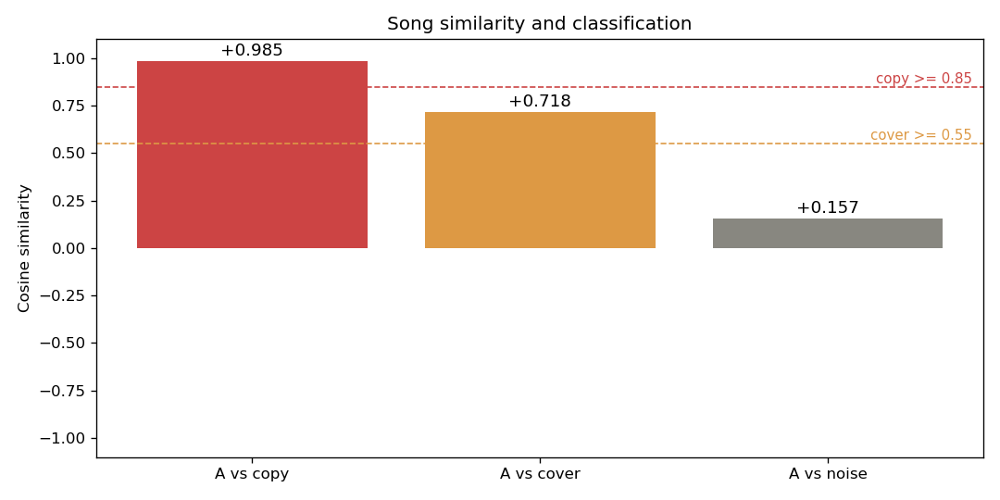

# 音乐歌曲比对项目（Music Similarity Comparator）

> 输入两首歌，程序计算它们的相似度分数，并自动判定为 **搬运 / 翻唱 / 不相关**。
> 用数字代替人耳的"像不像"，是音频信号处理 + 机器学习的入门级作品集项目。

---

## 一、项目简介

这个项目用来判断一首歌与原曲的关系，分为搬运、翻唱与不相关，也可以用于盗版检测。
做法是把一首歌的声波等信息转化为可量化的 24 位数字，再与原曲的 24 位数字用余弦相似度比较，越接近 1 代表越相似。

分类阈值：

| 相似度 | 判定 | 含义 |
|---|---|---|
| ≥ 0.85 | 搬运 (copy) | 几乎一模一样 |
| 0.55 ~ 0.85 | 翻唱 (cover) | 同一首歌的不同演绎 |
| < 0.55 | 不相关 (unrelated) | 完全不同的歌 |

---

## 演示效果



> 演示模式（`python main.py`）自动生成「搬运 / 翻唱 / 不相关」三个样本，并画出相似度柱状图与两条阈值线。

---

## 二、安装

建议使用 Miniconda 创建独立环境，避免系统 Python 的库冲突：

```bash
conda create -n music python=3.11 -y
conda activate music
conda install -c conda-forge --override-channels librosa matplotlib -y
pip install soundfile
```

（Windows 若提示缺少 `soundfile`，用 `pip install soundfile` 即可；其余库用 conda 装更稳定。）

---

## 三、使用方法

**比较两首歌：**

```bash
python main.py song1.mp3 song2.mp3
```

命令行会打印相似度分数与分类结果，并保存一张结果图 `result.png`。

**演示模式（无需歌曲，自动生成样本验证三类分类）：**

```bash
python main.py
```

---

## 四、项目结构

| 文件 | 说明 |
|---|---|
| `core.py` | 核心算法：指纹提取、余弦相似度、分类（模块化） |
| `main.py` | 主入口：CLI 调用，支持两首歌比对 / 演示模式 |
| `stage1_audio_viz.py` | 阶段1：读音频 + 画波形/梅尔频谱（可视化入门） |
| `stage2_feature_extraction.py` | 阶段2：提取 MFCC 与 Chroma 特征 |
| `stage3_similarity.py` | 阶段3：计算两首歌相似度（核心算法雏形） |
| `stage4_classify.py` | 阶段4：按阈值自动分类 |
| `tune_cover.py` | 调参脚本：验证特征改进效果（论文附录素材） |
| `开发笔记.md` | 中文开发笔记（英文论文的素材库） |
| `音乐歌曲比对项目-学习路线图.md` | 整体分阶段计划 |

生成的结果图：`result.png`、`stage1_*.png`、`stage2_*.png`、`stage3_similarity.png`、`stage4_classify.png`

---

## 五、技术说明

- **指纹向量（24 维）** = MFCC 第 1~12 维均值（描述音色/音高轮廓）
  + Chroma 12 维均值（描述音高/旋律，对转调敏感）。
- **相似度度量**：余弦相似度，范围 [-1, 1]，越接近 1 越相似。

### 关键技术改进（踩坑记录）

最初版本直接拼接全部 MFCC（含第 0 维 log-energy）与 Chroma 的均值，
实验发现相似度几乎只反映"响度"，导致**只能区分"几乎一样"和"完全无关"两档**，
中间档（翻唱）无法出现。

**改进方案：**
1. 去掉 MFCC 第 0 维（能量维），避免响度主导；
2. 将 MFCC 块与 Chroma 块**分别做 L2 归一化**，使两块贡献均衡。

改进后三类分数清晰拉开（演示：copy≈0.98、cover≈0.72、noise≈0.21）。

---

## 六、已知局限与后续方向

- 当前用"全曲平均特征"，对**变调翻唱**的区分力有限；
  后续可改用基于时间对齐（DTW）的 Chroma 序列比对来提升翻唱识别。
- 阈值（0.85 / 0.55）为经验值，建议在带标注的数据集上用
  混淆矩阵 / ROC 调优。
- 真实歌曲测试样本不足，分类边界有待更多样本验证。

---

## 七、环境说明

- Python 3.11（conda 环境 `music`）
- 依赖：numpy, librosa, matplotlib, soundfile
- 注意：本项目在 Python 3.14 的 pip 环境下，librosa 依赖的 numba 编译型 DLL
  会被部分系统的应用控制策略拦截，因此统一使用 conda 环境运行。
