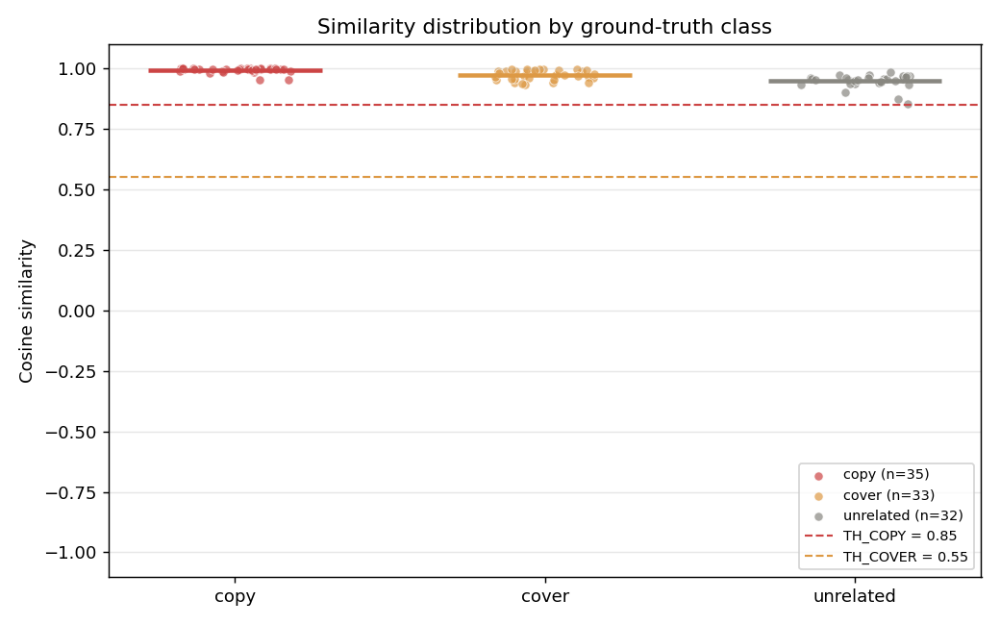
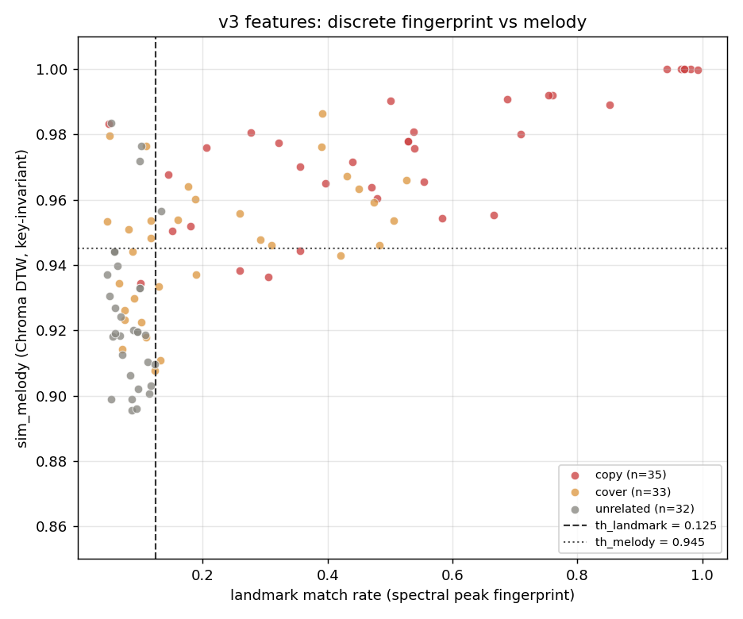

# 音乐歌曲比对项目（Music Similarity Comparator）

> 输入两首歌，程序计算它们的相似度分数，并自动判定为 **搬运 / 翻唱 / 不相关**。
> 用数字代替人耳的"像不像"，是音频信号处理 + 机器学习的入门级作品集项目。

---

## 一、项目简介

这个项目用来判断一首歌与原曲的关系，分为搬运、翻唱与不相关，也可以用于盗版检测。
做法是把一首歌的声波等信息转化为可量化的 24 位数字，再与原曲的 24 位数字用余弦相似度比较，越接近 1 代表越相似。

分类阈值：

| 相似度 | 判定 | 含义 |
|---|---|---|
| ≥ 0.85 | 搬运 (copy) | 几乎一模一样 |
| 0.55 ~ 0.85 | 翻唱 (cover) | 同一首歌的不同演绎 |
| < 0.55 | 不相关 (unrelated) | 完全不同的歌 |

> 注：以上是 **v1 基线**（全曲平均指纹）的判定规则，仅用于教学演示。
> v1 在 100 对真实标注数据上只有 35% 准确率，已被证伪。
> **实际比对请用 `python predict.py song1 song2`**（v3 特征 + 训练好的分类器），
> 版本演进与实测对比见「六、真实数据集评测」和 `model_card.md`。

---

## 演示效果


> 演示模式（`python main.py`）自动生成「搬运 / 翻唱 / 不相关」三个样本，并画出相似度柱状图与两条阈值线。

---

## 二、安装

建议使用 Miniconda 创建独立环境，避免系统 Python 的库冲突：

```bash
conda create -n music python=3.11 -y
conda activate music
conda install -c conda-forge --override-channels librosa matplotlib scikit-learn -y
pip install soundfile joblib
```

（Windows 若提示缺少 `soundfile`，用 `pip install soundfile` 即可；其余库用 conda 装更稳定。）

---

## 三、使用方法

**① 比对两首歌（推荐，用的是改进版模型）：**

```bash
python predict.py song1.mp3 song2.mp3
python predict.py song1.mp3 song2.mp3 --json     # 机器可读输出
```

输出三分类结果、置信度、三路中间分数。首次使用需先训练模型：

```bash
python train_model.py        # 用 100 对标注数据训练，导出 model_bundle.joblib + model_card.md
```

模型只含系数与标准化统计量，不含任何音频或文件名，已随仓库提供。

**② 教学演示（v1 原始算法，仅用于讲解）：**

```bash
python main.py               # 合成正弦波 vs 白噪声，生成 result.png
python main.py a.mp3 b.mp3   # 也会自动转发到 predict.py 的改进版推理
```

> `main.py` 保留的是最初版本，用来演示「波形 → 24 维指纹 → 余弦相似度」的基础链路；
> 它**不代表当前算法性能**。真实比对一律用 `predict.py`。

**③ 复现实验与自检：**

```bash
python -m unittest discover -s tests -v    # 14 个核心算法测试
python reproduce.py --list                 # 查看全部复现步骤
python reproduce.py --run                  # 快速组（约 5 分钟）
python reproduce.py --run --full           # 连音频重算一起跑（约 10 分钟）
```

---

## 四、项目结构

| 文件 | 说明 |
|---|---|
| `core.py` | 核心算法：指纹提取、余弦相似度、分类（模块化） |
| `main.py` | 主入口：CLI 调用，支持两首歌比对 / 演示模式 |
| `stage1_audio_viz.py` | 阶段1：读音频 + 画波形/梅尔频谱（可视化入门） |
| `stage2_feature_extraction.py` | 阶段2：提取 MFCC 与 Chroma 特征 |
| `stage3_similarity.py` | 阶段3：计算两首歌相似度（核心算法雏形） |
| `stage4_classify.py` | 阶段4：按阈值自动分类 |
| `tune_cover.py` | 调参脚本：验证特征改进效果（论文附录素材） |
| `evaluate_dataset.py` | v1 评测：100 对标注音频上的准确率 / 混淆矩阵 / 阈值搜索 |
| `core_v2.py` / `evaluate_v2.py` | v2：特征序列 + 子序列 DTW + 转调不变，及其评测 |
| `core_v3.py` / `evaluate_v3.py` | v3：频谱峰值 landmark 指纹 + 逻辑回归对照，及其评测 |
| `optimize_model.py` | 独立测试集口径：25% 留出 + 9 个分类器规范对比 + 20 次划分稳定性 |
| `core_v4.py` / `evaluate_v4.py` | v4：旋律级新特征（移位置信度 / 变速 / 分段一致性）及其评测 |
| `optimize_v4.py` / `diagnose_v4.py` | 三组特征集严格对比、相关性与增量诊断（负结果记录） |
| `core_v5.py` / `evaluate_v5.py` | v5：CENS 色度 + 节奏/起音（全新信息源）及其评测 |
| `optimize_v5.py` / `optimize_rules.py` | 嵌套评估：新特征与极简可解释规则的严格验证 |
| `diagnose_audio_quality.py` | 音频质量诊断（静音 / 时长 / 削波），排除输入层面的问题 |
| `features_runtime.py` | **训练与推理共用的特征提取**，保证两侧分数不漂移 |
| `train_model.py` | 训练并导出 `model_bundle.joblib` + `model_card.md` |
| `predict.py` | **实际推理入口**：两首歌 → 三类判定 + 置信度 |
| `tests/test_core.py` | 14 个核心算法不变量测试 |
| `reproduce.py` | 一键复现全部实验 |
| `error_analysis.py` | 越折预测错误分析 → `ERROR_ANALYSIS.md` |
| `test_samples.py` | 小工具：把一个文件夹里的音频两两配对做快速比对 |
| `评测报告.md` | 真实数据集评测、原因分析与 v1→v5 全部改进/负结果实验记录（论文素材） |
| `ERROR_ANALYSIS.md` / `model_card.md` | 错误分布分析 / 模型卡（性能、局限、隐私） |
| `开发笔记.md` | 中文开发笔记（英文论文的素材库） |
| `音乐歌曲比对项目-学习路线图.md` | 整体分阶段计划 |

生成的结果图：`result.png`、`stage1_*.png`、`stage2_*.png`、`stage3_similarity.png`、`stage4_classify.png`

---

## 五、技术说明

- **指纹向量（24 维）** = MFCC 第 1~12 维均值（描述音色/音高轮廓）
  + Chroma 12 维均值（描述音高/旋律，对转调敏感）。
- **相似度度量**：余弦相似度，范围 [-1, 1]，越接近 1 越相似。

### 关键技术改进（踩坑记录）

最初版本直接拼接全部 MFCC（含第 0 维 log-energy）与 Chroma 的均值，
实验发现相似度几乎只反映"响度"，导致**只能区分"几乎一样"和"完全无关"两档**，
中间档（翻唱）无法出现。

**改进方案：**
1. 去掉 MFCC 第 0 维（能量维），避免响度主导；
2. 将 MFCC 块与 Chroma 块**分别做 L2 归一化**，使两块贡献均衡。

改进后三类分数清晰拉开（演示：copy≈0.98、cover≈0.72、noise≈0.21）。
注意这只是**合成演示样本**上的结果；在真实歌曲上，这种全曲平均指纹
会把 100 对样本全部判成"搬运"，详见第六节的定量评测。

---

## 六、真实数据集评测（100 对标注样本）

用 `python evaluate_dataset.py` 在一批**带人工标准答案**的真实音频上做了定量评测
（每首取前 60 秒；搬运 35 / 翻唱 33 / 不相关 32，共 100 对，解码成功率 100/100）。

| 指标 | 结果 |
|---|---|
| 准确率（原阈值 0.85 / 0.55） | **35.00%**（100 对全部被判成 copy） |
| 宏平均 F1 | 0.1728 |
| 网格搜索最优阈值（0.98 / 0.97） | 准确率 65.00% |

三类的余弦相似度几乎全部挤在 0.85~1.00 的窄带内：
copy 均值 +0.993、cover +0.973、unrelated +0.948，分布严重重叠。



**结论**：问题不在阈值，而在特征本身——"全曲时间平均 + 分块 L2 归一化"
把时序与幅度信息一并抹平了，导致任意两首真实音乐的指纹都很接近。
之前演示模式能分三类，是因为用的是合成正弦波与白噪声这类极端对照，结论不能外推到真实录音。

详细数据表、混淆矩阵、原因分析与改进方向见 [评测报告.md](评测报告.md)；
聚合统计在 `eval_summary.json`，混淆矩阵图在 `eval_confusion.png`。

### 改进实验：从 35% 到 72%

| 版本 | 做法 | 准确率 |
|---|---|---|
| v1 原始 | 24 维全曲平均 + 余弦 + 经验阈值 | 35%（全量评测，未调参） |
| v2 | 特征序列 + 子序列 DTW + 转调不变 | 52%（5 折 CV） |
| v3 | 频谱峰值 landmark 指纹 + key-invariant Chroma DTW | 58%（5 折 CV，手工阈值） |
| v3 + 逻辑回归 | 同上三路分数 (landmark / timbre / melody) | **72%（分层 5 折 CV）** |

离散频谱峰值匹配把「搬运」与「不相关」分得很干净（landmark 均值 0.529 / 0.083），
但「翻唱」仍是难点（recall 0.18）。三路分数交给逻辑回归后，无需改特征就把准确率
从 58% 提到 72%。完整数据、混淆矩阵与方法演进见 [评测报告.md](评测报告.md) 第 8 节。



### 更严谨的复评：数字到底有多稳？

上面的 72% 是「在同一批 100 对上挑模型 + 5 折 CV」，仍偏乐观。
`optimize_model.py` 改为：先留出 25% 独立测试集（全程不参与模型选择），
剩 75 对用重复分层 CV 选模型，测试集只评一次，并跑 20 种不同划分看波动。

| 指标 | 结果 |
|---|---|
| 独立测试集准确率 / macro-F1 | 0.720 / 0.709（n=25） |
| 20 种划分准确率均值 | **0.672** |
| 20 种划分范围 | **0.52 ~ 0.88** |

之后又做了两轮优化，均为**负结果**（详见 [评测报告.md](评测报告.md) 第 9 节）：

- 换 9 种更复杂分类器（SVM / 随机森林 / 梯度提升 / 多项式特征等）**全部不如原逻辑回归**；
- 补 8 个旋律级新特征，单看类别均值梯度很漂亮，但严格对比后 20 次划分均值
  从 0.672 降到 0.662 / 0.648。相关性诊断显示 `tempo_best` 与旧 `sim_melody`
  相关系数 **0.990**，几乎没带来独立信息，只增加了过拟合风险。

**所以优化到此为止是主动决定，不是没做完**：100 对样本上继续调参只会过拟合。
对外统一口径为「约 67%（20 次划分均值）」，并注明波动区间。

### 后续又试了三条正当路线（v5，仍未突破天花板）

| 尝试 | 结果 |
|---|---|
| **音频质量诊断** | 195 个文件全部解码成功，平均静音 1%，无前导静音，11 条难例也无异常 → 输入没问题，排除这个变量 |
| **CENS 色度 + 节奏/起音**（全新信息源） | 与旧特征相关性只有 0.41~0.87（v4 是 0.99），确有新信息；`rhythm_acf_sim` 三类均值 **0.894 / 0.723 / 0.432**。但嵌套 20 次划分 **delta = −0.008** |
| **极简可解释规则**（只 2 个阈值） | 嵌套 delta **+0.044**（0.578→0.622），20 次里 13 次自动选中带节奏特征的规则；但仍低于逻辑回归 0.660 |

节奏特征是真有用的，但 100 对样本撑不住更多维度带来的方差。
**准确率天花板约 67~72%，由数据规模决定，不是代码能调出来的。**
详见 `评测报告.md` 第 10 节与 `ERROR_ANALYSIS.md`。

### 第四轮：换决策结构 + 换信号表示（有正信号，但统计上不显著）

这一轮不再"再加一维特征"，而是改两件更本质的东西，并第一次做**配对显著性检验**：

| 组 | 做法 | 20 次划分均值 | 翻唱 recall |
|---|---|---|---|
| G0 | v3 三路特征 + 扁平三分类（生产基线） | 0.672 | 0.369 |
| G1 | 只把三分类拆成两级二分类 | 0.668 | 0.388 |
| G2 | 两级结构 + v4/v5 旧特征 | 0.686 | 0.450 |
| G3 | 再加 v6（谐波分离 + CQT 色度 + 离散音级轮廓） | **0.696** | **0.494** |

- **结构性改动**：`HierarchicalClassifier` 先判 copy vs rest，再在剩下的里判
  cover vs unrelated，每层只学一条边界。单独用没有提升（−0.004）。
- **信号表示改动**：v6 先分离谐波（去鼓点）再算 CQT 色度，并把每 0.5 秒的
  主音级变成 0~11 的整数序列做**离散符号匹配**。诊断再次抓到冗余：
  `hpcp_sim` 与旧 `sim_cens` 相关 **0.965**（CENS 本就是 CQT 色度的变体）；
  真正带来新信息的是 `pitch_shift_zero`（0.800 / 0.333 / 0.031，相关仅 0.640）
  与 `pitch_match`（0.619 / 0.361 / 0.257）。
- **但提升不能对外宣称**：G3−G0 = +0.024，20 次配对划分 10 胜 6 平 4 负，
  配对 t 检验 p=0.356、Wilcoxon p=0.160，**均不显著**。

因此**生产模型保持 v3 基线不变**——为 2 个不显著的点去增加推理复杂度
（每次多算一次 CQT）不划算。v6 作为完整可复现实验保留，数据见
`hierarchical_report.json`、`eval_v6_feature_stats.json`，详见 `评测报告.md` 第 11 节。

### 工程闭环：把「评测脚本」变成「可用工具」

这一轮更重要的修复是：**此前 `main.py` 跑的仍是已被证伪的 v1**。
也就是说项目里躺着改进算法，但用户真正执行时拿到的是 35% 准确率的结果。现在：

- `features_runtime.py` 统一训练与推理的特征计算，实测三路分数与训练 CSV **完全一致**（0.7099 / 0.9851 / 0.9801），无分布漂移；
- `train_model.py` 导出 `model_bundle.joblib` + `model_card.md`（性能、局限、隐私声明）；
- `predict.py` 成为真正的推理入口，同歌自比 `landmark = 1.0`、正确判为搬运；
- `tests/test_core.py` 14 个自动化测试，并顺手修掉 `classify()` 返回 `"copy (搬运)"` 与文档口径不一致的 bug；
- `reproduce.py` 一键复现 7 个步骤（实测 313 秒全部通过）；
- `ERROR_ANALYSIS.md` 用越折预测指出：翻唱 recall 0.424、难例准确率 54.6% vs 其他 74.2%。

---

## 七、已知局限与后续方向

- **翻唱识别仍是瓶颈**：v3 中翻唱 recall 仅 0.182，它夹在搬运与不相关之间——
  高逼真度翻唱易被当成搬运，变调 / 变速 / 纯伴奏又易被当成不相关。
  HPCP / CQT-Chroma + 离散音级轮廓已试（v6），翻唱 recall 在嵌套评估里从
  0.369 提到 0.494，但整体准确率提升不显著；仍未突破样本量天花板。
  后续可试节拍无关的 n-gram 哈希或显式建模音色差异。
- **v1 全曲平均特征已被证伪**（100 对标注数据上仅 35%），保留在仓库中作为对照基线；
  实际使用请用 `python predict.py song1 song2`（v3 三路分数 + 训练好的逻辑回归）。
  越折预测下翻唱 recall 为 0.424，仍是最弱的一类。
- **样本规模有限**：100 对且来自单一来源。独立测试集准确率 0.72，但换 20 种划分
  会在 0.52~0.88 之间波动（均值 0.672），说明这个数字本身置信区间很宽；
  难例（变速、纯伴奏、低音量翻唱）覆盖不足。
- **调参口径**：只引用「重复分层 CV / 独立测试集 / 20 次划分均值」，
  不引用「同一批数据上调出来的最优值」。
- **手工特征路线已到边界**：换模型（9 种）、加相关特征（v4）、加全新节奏特征
  （v5）、改两级决策结构、换谐波 / CQT / 离散音级表示（v6）全部试过，
  要么负结果，要么提升不显著（第 6 节、报告第 9~11 节）。
  **注意 v4→v6 的证据链**：单看三类均值分离度都很漂亮，但相关系数诊断
  反复证明它们与旧分数高度重合；即使找到真独立的特征，100 对样本也撑不住
  额外维度带来的方差。
- **真正能提升准确率的三条路（都需要换资源，不是再调一轮参数）**：
  ① **扩充标注数据** —— 尤其翻唱难例。当前 100 对、来源单一，是最大瓶颈，
  也是唯一能同时降低方差的办法；
  ② **预训练音频嵌入**（CLAP / MERT / OpenL3 / VGGish）—— 模型已在海量音频上
  学过表征，只需少量样本训练线性分类头。代价：需安装 PyTorch 并下载数 GB 权重；
  ③ **人声/伴奏分离**（Demucs 等）后单独提旋律轮廓 —— 同样需要下载模型权重。
  「把三分类拆成两个二分类」已在本轮验证（G1），单独使用无提升。

---

## 八、环境说明

- Python 3.11（conda 环境 `music`）
- 依赖：numpy, librosa, matplotlib, soundfile, scikit-learn, scipy, joblib
  （见 `requirements.txt`；训练与推理共用 `features_runtime.py`）
- 注意：本项目在 Python 3.14 的 pip 环境下，librosa 依赖的 numba 编译型 DLL
  会被部分系统的应用控制策略拦截，因此统一使用 conda 环境运行。
