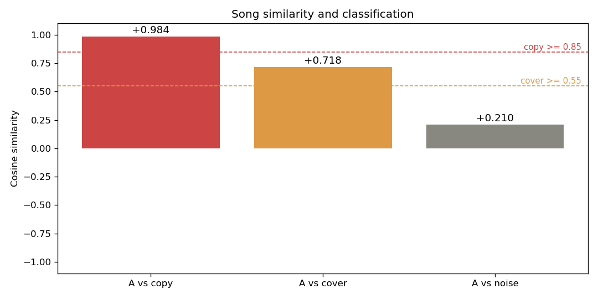

# 我用 Python 写了个能分辨「搬运 / 翻唱」的音频比对工具（附完整踩坑过程）

> 建议标签：`#showdev` `#python` `#机器学习` `#音频处理` `#新手`
> 封面图：用仓库里的 `result.png`（文章里也会嵌同一张图）

一句话介绍：给两首歌，它能算出「有多像」，并自动判成 **搬运 / 翻唱 / 不相关**。底层是 MFCC + Chroma 特征 + 余弦相似度。



---

## 为什么做这个

刷视频时常看到「这歌是不是搬运 / 翻唱」的争论。人耳能听个大概，但没法量化。我就想：能不能用一段 Python，把「像不像」变成一个 0~1 之间的数字？

这成了我第一个正经的作品集项目——也是第一次完整走完「想法 → 代码 → 踩坑 → 修好 → 写出来」的全过程。

## 它能做什么

- 输入两首歌（mp3 / wav），输出一个**相似度分数** + **分类**：
  - `≥ 0.85` → 搬运（copy，几乎一模一样）
  - `0.55 ~ 0.85` → 翻唱（cover，同一首歌的不同演绎）
  - `< 0.55` → 不相关（unrelated，完全不同的歌）
- 跑 `python main.py` 进入演示模式，自动造「搬运 / 翻唱 / 不相关」三个样本验证分类，并画出上面的柱状图（两条虚线是阈值）。

## 核心思路

把一首歌压成一段固定长度的「指纹向量」，再和另一首的指纹算**余弦相似度**——越接近 1 越像。

指纹 = **24 维**：
- MFCC 第 1~12 维的均值（描述音色 / 音高轮廓）
- Chroma 12 维的均值（描述旋律，对转调敏感）

```python
import numpy as np, librosa

def fingerprint(y, sr=22050):
    mfcc   = librosa.feature.mfcc(y=y, sr=sr, n_mfcc=13)
    chroma = librosa.feature.chroma_stft(y=y, sr=sr)
    mf = mfcc[1:, :].mean(axis=1)        # 去掉第 0 维（能量维）
    ch = chroma.mean(axis=1)
    mf = mf / (np.linalg.norm(mf) + 1e-9)   # 分块 L2 归一化
    ch = ch / (np.linalg.norm(ch) + 1e-9)
    return np.concatenate([mf, ch])      # 24 维指纹
```

分类就是拿分数对阈值「切三刀」：

```python
def classify(sim):
    if   sim >= 0.85: return "copy (搬运)"
    elif sim >= 0.55: return "cover (翻唱)"
    else:             return "unrelated (不相关)"
```

## 真正的坑：MFCC 第 0 维

最早我直接把**全部 MFCC（含第 0 维 log-energy）**和 Chroma 拼一起求平均。结果翻唱和原曲的相似度低得离谱，三类根本拉不开——只有「几乎一样」和「完全无关」两档，**中间的「翻唱」死活出不来**。

原因后来才想明白：MFCC 第 0 维是**响度（能量）**，它数值大、方差也大，直接把余弦相似度「绑架」成了「比谁更响」，把音高 / 音色的差异全淹了。

修复就两步：
1. **丢掉 MFCC 第 0 维**；
2. 把 MFCC 块和 Chroma 块**分别做 L2 归一化**，让两块贡献均衡。

改完，三类分数干净地拉开了（演示结果：搬运 ≈ 0.98、翻唱 ≈ 0.72、不相关 ≈ 0.16）。这个 bug 比「把项目做出来」本身更让我学到东西——**特征怎么选，比模型多复杂更重要**。

## 怎么跑

```bash
conda create -n music python=3.11 -y
conda activate music
conda install -c conda-forge librosa matplotlib -y
pip install soundfile

python main.py song1.mp3 song2.mp3   # 比两首歌
python main.py                       # 演示模式（自动造样本）
```

> 小提示：Windows 上 Python 3.14 的 pip 环境会因「应用控制策略」拦截 numba 的 DLL，所以统一用 conda 环境最稳。

## 局限 & 下一步

- 现在用的是「全曲平均特征」，对**变调翻唱**区分力有限 → 下一步可上 **DTW 时间对齐**的 Chroma 序列比对。
- 阈值（0.85 / 0.55）是经验值，应该在带标注的数据集上用混淆矩阵 / ROC 调优。
- 真实歌曲样本还不够多，分类边界有待更多样本验证。

## 后续更新：真实数据把我打脸了

文章写完不久，我拿到了一批**带人工标准答案**的真实音频比对样本（100 对，
搬运 35 / 翻唱 33 / 不相关 32），终于能不靠"看着像"来验货了。结果：

- 原来的 24 维平均指纹 + 余弦相似度，**准确率只有 35%**，100 对全被判成"搬运"。
- 三类的相似度全挤在 0.85~1.00：搬运 0.993 / 翻唱 0.973 / 不相关 0.948。
  调阈值最多也只到 65%——因为问题根本不在阈值，全曲时间平均把时序信息抹平了。
- 上面写的"改完三类分数干净地拉开了"是**合成演示样本**（正弦波 vs 白噪声）的结果。
  那种极端对照，任何粗糙特征都能分开，不能外推到真实录音。这点我当时没意识到。

于是重做了两版：

| 版本 | 做法 | 5 折交叉验证准确率 |
|---|---|---|
| v2 | 0.5 秒/桶的特征序列 + 子序列 DTW + 12 半音循环移位（转调不变） | 52% |
| v3 | Shazam 式频谱峰值指纹（landmark）+ key-invariant Chroma DTW | 58%（手工阈值） |
| v3 + LR | 三路分数交给逻辑回归 | **72%** |

离散峰值匹配把搬运与不相关分得很干净（landmark 均值 0.529 / 0.083），
但翻唱 recall 只有 0.18——它夹在中间，仍是最难的一类。
最后一步没改特征，只把手工阈值换成从数据学出来的分类器，就从 58% 提到 72%：
**先做出有区分力的特征，再让数据决定边界**，比反复手调阈值有效得多。

最大的收获其实不是那 72%，而是：一个只在玩具数据上"看起来 98% 准确"的项目，
和拿 100 对真实标注数据验过、知道自己错在哪、还给出可验证改进路径的项目，
后者才值得写进简历。评测脚本、混淆矩阵和完整数据都在仓库里。

### 再补一段：我还试了什么，以及为什么停手

72% 报出去之前我又心虚了一次——**模型是我看着同一批 100 对数据挑的**，这个数字偏乐观。
改成"先留出 25% 完全不碰的测试集，剩下 75 对才用来选模型"，又跑了 20 种不同划分，
结果是：独立测试集 0.72，但 20 次划分均值只有 **0.672**，范围 **0.52~0.88**。
100 对样本下，换个划分数字就能晃 30 多个点，所以现在我只说"约 67%，波动很大"。

然后我又认真攻了一下最难的翻唱，两次都没成：

- **换更复杂的模型**：SVM、随机森林、梯度提升、二次多项式特征，9 个候选全试了，
  没有一个打得过原来那个最朴素的逻辑回归。说明瓶颈不在决策边界。
- **加旋律级新特征**：我发现原来的 Chroma 比对做了 12 个半音移位、只取最好的那个，
  等于白送给不相关的歌 12 次撞运气的机会。于是把丢掉的 11 个结果捡回来，
  做了"最优移位比次优好多少""变速后还像不像""切三段是否段段吻合"等 8 个特征。
  单看三类的均值梯度漂亮极了（搬运 0.10 / 翻唱 0.05 / 不相关 0.01），
  **但加进模型一点没涨**。一查相关系数就明白了：`tempo_best` 和旧的 `sim_melody`
  相关性 **0.990**——根本是同一个数换了个写法，不带新信息，只多带来了过拟合。

所以我停手了。不是"做完了"，是**再往下调就是在 100 条数据里背答案**。
真要再进一步，得换资源：更多带标注的翻唱难例、人声分离后的旋律轮廓，
或者干脆上预训练音频嵌入——都不是"再调一轮参数"能解决的事。

现在回头看，这两次没成功的尝试反而是我最想跟人聊的部分：
**单看均值有区分力 ≠ 能给模型带来新信息**，这个坑我以前连想都想不到。

---

## 仓库

👉 https://github.com/shuangqiliang61-web/music-similarity-comparator

欢迎 Star、提 Issue，或者告诉我你踩过的音频处理坑。我是新手，正在攒作品集准备申请海外实习，任何反馈都超有价值 🙏

---

*如果你也想从零做一个能写进简历的小项目，这个「选特征 → 写相似度 → 调阈值 → 踩坑」的套路其实很好复用，欢迎一起交流。*
