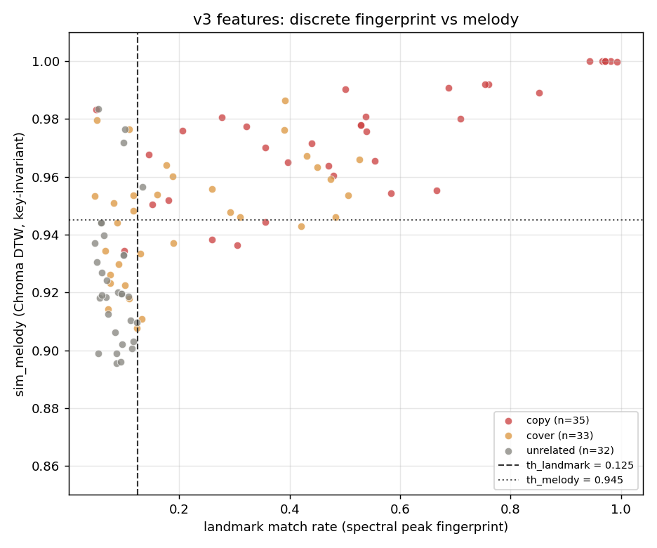

# 真实数据集评测报告（100 对标注样本）

> 复现命令：`python evaluate_dataset.py`（每首取前 60 秒，22 050 Hz 单声道）
> 明细：`samples/eval_results.csv`（含原始文件名，**仅本地，勿外传**）
> 聚合数据：`eval_summary.json`；图：`eval_distribution.png`、`eval_confusion.png`

## 1. 数据集

一批带人工标注的真实音频比对样本，共 **100 对**，每对由「查询音频 qry」与「参考音频 ref」组成，真值分三类且基本均衡：

| 真值 | 数量 |
|---|---|
| 搬运 copy | 35 |
| 翻唱 cover | 33 |
| 不相关 unrelated | 32 |

格式覆盖 mp3 / mp4 / m4a / ogg。清单中 100 对文件在本地全部可定位，解码成功率 **100/100**。
清单另含 11 条难例备注，例如「查询的节奏加快」「纯背景音乐」「翻唱，声音很小」。

## 2. 方法

沿用 `core.py` 的定义，不做任何改动：

- 指纹 = MFCC 第 1~12 维时间均值（L2 归一化）+ Chroma 12 维时间均值（L2 归一化），共 24 维
- 相似度 = 两个指纹的余弦相似度
- 阈值：≥ 0.85 判 copy，≥ 0.55 判 cover，否则 unrelated

与演示模式的区别：这次是**真实音乐 + 人工标注的标准答案**，不是合成音。

## 3. 结果

### 3.1 原阈值（0.85 / 0.55）

**准确率 35.00%，宏平均 F1 = 0.1728** —— 100 对被**全部判成 copy**。
由于数据集中 copy 恰好占 35%，这个数字等价于「只会猜多数类」。

混淆矩阵（行 = 真值，列 = 预测）：

|  | copy | cover | unrelated |
|---|---|---|---|
| **copy** | 35 | 0 | 0 |
| **cover** | 33 | 0 | 0 |
| **unrelated** | 32 | 0 | 0 |

### 3.2 相似度分布

| 真值 | 均值 | 中位数 | 范围 |
|---|---|---|---|
| copy | +0.993 | +0.997 | +0.954 ~ +1.000 |
| cover | +0.973 | +0.974 | +0.933 ~ +0.998 |
| unrelated | +0.948 | +0.956 | +0.855 ~ +0.983 |

三类分数几乎全部落在 **0.85~1.00** 的窄带里，两条阈值线（0.85 / 0.55）都在数据下方，
完全没有起到分隔作用。均值虽有 copy > cover > unrelated 的微弱梯度，但分布重叠严重。

### 3.3 调阈值还能救回来吗？

在 0.30~0.99 区间做网格搜索，最优组合 `copy ≥ 0.98 / cover ≥ 0.97`，
准确率也只有 **65.00%**。说明问题**不在阈值，而在特征本身缺乏区分力**。

## 4. 原因分析

1. **全曲时间平均把时序信息抹平了**。24 维向量只剩「整首歌的平均频谱包络 + 平均音高分布」，
   不同歌曲之间这两项本来就很接近，余弦相似度自然普遍趋近 1。
2. **分块 L2 归一化进一步压缩了幅度差异**。它解决了演示里「响度主导」的问题，
   但也把剩下能区分歌曲的能量 / 动态信息一并去掉了。
3. **演示模式的高分是假象**。演示用的是纯正弦波旋律 + 白噪声，属于极端对照，
   任何粗糙特征都能分开；这个结论不能外推到真实录音。
4. 结论：原先 README 里凭直觉写下的「全曲平均特征区分力有限」，
   在真实标注数据上被**定量证实**了。

## 5. 改进方向（按预期收益排序）

1. **保留时序**：改用 Chroma 序列 + DTW 动态时间规整对齐，而不是先求均值；
   能同时应对变调、变速、片段截取（备注里的「节奏加快」正是这类难例）。
2. **局部指纹 / landmark**：Shazam 式的频谱峰值哈希，
   用「匹配上的峰值数量」代替余弦相似度，对搬运（同一录音）会非常灵敏。
3. **增加区分性特征**：spectral contrast、spectral centroid / bandwidth 的统计量、
   tempo / beat 特征，而不只用 MFCC 与 Chroma 的均值。
4. **在标注集上规范调参**：已有 100 对标准答案，可从「拍脑袋阈值」
   升级为「划分训练 / 验证集调参或训练分类器」，评测也更规范
   （避免在同一批数据上既调参又报告准确率）。

## 6. 对作品集的意义

一个能**诚实报告失败、定位原因、给出可验证改进方案**的项目，
比一个只在合成数据上「看起来 98% 准确」的玩具更有说服力。
这段实测可以直接作为英文论文 / 技术报告的 **Experiments** 与 **Limitations** 两章核心内容。

## 7. 复现

```bash
conda activate music
python evaluate_dataset.py             # 全量 100 对
python evaluate_dataset.py --limit 10  # 试跑前 10 对
```

> **隐私**：测试音频、明细 CSV 与原始文件名均属内部资料，只保留在本地 `samples/`
> （已被 `.gitignore` 忽略）。对外只使用本报告的聚合数字与图，不公开任何原始文件名。

---

## 8. 算法改进实验：从 35% 到 72%

针对第 4 节定位的原因，依次做了三版特征 / 判定方法，全部在**同一套 100 对标注数据**上评测，
统一用「5 折交叉验证」作为可信口径（调参只用 4 折，在留出折上测，避免自欺）。

| 版本 | 做法 | 判定方式 | 准确率 |
|---|---|---|---|
| v1（原始） | 24 维全曲平均指纹 + 余弦 | 经验阈值 0.85 / 0.55 | **35.00%**（全量评测，未调参） |
| v2 | 特征序列（0.5s/桶）+ 子序列 DTW + 12 半音循环移位 | 两级阈值（timbre / melody） | **52.00%**（5 折 CV） |
| v3 | 频谱峰值 landmark 指纹 + key-invariant Chroma DTW | 两级阈值 | **58.00%**（5 折 CV） |
| v3 + LR | 同上三路分数 | scikit-learn 逻辑回归 | **72.00%**（分层 5 折 CV） |

> 口径说明：v1 的 35% 是全量评测的原始准确率；v1 在同一批数据上网格搜索得到的 65%
> 因为没有独立验证集，属于乐观上界，不与后面几版的 CV 数字直接等同。

### 8.1 v2：保留时序，但连续特征仍然饱和

把全曲平均改成「每 0.5 秒一帧的特征序列」，用子序列 DTW 对齐（允许短片段在长音频里滑动），
Chroma 再做 12 个半音循环移位取最优，从而对变调不变。三类均值终于出现正确梯度：

| 真值 | sim_timbre | sim_melody |
|---|---|---|
| copy | 0.976 | 0.974 |
| cover | 0.956 | 0.947 |
| unrelated | 0.944 | 0.925 |

但分数依然挤在 0.92~0.99，类间间隔只有 0.02~0.05。诊断实验显示：
仅靠这两个分数，把 kNN（k=1~15）、各种两级阈值都试一遍，5 折 CV 天花板约 **58%**。
说明「归一化连续特征的余弦相似度」这条路本身信息量有限，不是阈值没调好。

### 8.2 v3：改用离散频谱峰值指纹

换掉连续余弦，改用 Shazam 式离散匹配：提取 STFT 频谱峰 (t, f)，
统计 qry 与 ref 中同频率峰的时间差 Δ；同一录音会让大量峰落在同一个 Δ 上，
形成尖锐的直方图峰。归一化后的 landmark 分数分离度大幅提升：

| 真值 | landmark 均值 | 中位数 | 范围 |
|---|---|---|---|
| copy | **0.5292** | 0.5282 | 0.049 ~ 0.993 |
| cover | 0.2192 | 0.1322 | 0.048 ~ 0.527 |
| unrelated | **0.0833** | 0.0865 | 0.047 ~ 0.134 |

混淆矩阵（调优阈值 th_landmark=0.125 / th_melody=0.945）：

|  | 判 copy | 判 cover | 判 unrelated |
|---|---|---|---|
| **copy** | 33 | 1 | 1 |
| **cover** | 18 | 6 | 9 |
| **unrelated** | 1 | 3 | 28 |

搬运 recall 0.943、不相关 recall 0.875，都很好；**翻唱 recall 只有 0.182**——
它夹在中间，既可能被当成搬运（高逼真度翻唱，备注里有「疑似逼真度高」），
也可能被当成不相关（变调 / 变速 / 纯伴奏），是这套数据里真正的难点。



### 8.3 最后一步：让分类器代替手工阈值

两级阈值是「轴对齐」的决策边界，而三类在 (landmark, timbre, melody) 空间里
更适合斜的分界。把三路分数标准化后交给 `LogisticRegression`，
用分层 5 折交叉验证，准确率 **72.00%**（各折 0.70 / 0.80 / 0.65 / 0.65 / 0.80）。
这一步没有改特征，只换了判定方式，就比手工阈值高了 14 个百分点——
说明「先做出有区分力的特征，再让数据决定边界」比反复手调阈值有效得多。

### 8.4 结论与后续

1. **v1 的失败是特征问题，不是阈值问题**：全曲平均 + L2 归一化把区分信息抹平了。
2. **离散指纹在本任务上明显优于连续余弦**：搬运与不相关一旦用峰值匹配，几乎线性可分。
3. **翻唱仍是瓶颈**：需要真正的旋律级表示，下一步可试 HPCP / CQT-Chroma + DTW、
   节拍无关的 n-gram 哈希，或显式建模「音色差异」。
4. **规范评测很重要**：同一批数据上调参报出的 67% 比交叉验证的 58% 好看，
   但后者才是可对外说的数字。

复现：

```bash
conda activate music
python evaluate_dataset.py    # v1
python evaluate_v2.py         # v2
python evaluate_v3.py         # v3 + 逻辑回归对照
```

---

## 9. 再往前一步：规范化评估与两轮优化尝试（含负结果）

第 8 节报出的 72% 有一个隐患：**模型本身也是看着这 100 对数据挑的**。
于是又做了两件事：先把评估口径做严谨，再尝试把翻唱真正拉起来。

### 9.1 独立测试集：72% 有多少是运气？

新协议（`optimize_model.py`）：

1. 先切出 **25% 分层独立测试集**（25 对，seed=42），全程不参与任何选择；
2. 只在剩下 75 对上用 `RepeatedStratifiedKFold(5×4)` 比较候选模型，按 **macro-F1** 选；
3. 选好后训练一次，在测试集上**只评一次**；
4. 另做 20 种不同划分重跑，给出准确率的波动范围。

| 指标 | 结果 |
|---|---|
| 独立测试集准确率 / macro-F1 | **0.720 / 0.709**（n=25） |
| 20 种划分准确率均值 | **0.672** |
| 20 种划分范围 | **0.52 ~ 0.88** |

**结论**：100 对样本下，单一数字非常不稳定（换个划分就能从 52% 晃到 88%）。
对外引用应写成「约 67%（20 次划分均值），单次 5 折 CV 曾达 72%」，并注明区间，
而不是只挑最好看的那一次。

### 9.2 尝试一：换更复杂的分类器 —— 无效

在 75 对上比较 9 个候选（标准化与拟合全部封装在 Pipeline 内，避免数据泄漏）：

| 模型 | 重复 CV 准确率 | macro-F1 |
|---|---|---|
| **LogReg（v3 原方案）** | **0.643 ± 0.145** | **0.618** |
| LogReg 类别加权 | 0.643 | 0.614 |
| SVC rbf C=1 / C=10 | 0.600 / 0.603 | 0.572 / 0.579 |
| LogReg + 二次多项式 | 0.597 | 0.578 |
| RandomForest | 0.583 | 0.574 |
| kNN k=5 | 0.577 | 0.565 |
| HistGradientBoosting | 0.573 | 0.549 |

非线性模型全部更差。**瓶颈不在决策边界，在特征本身。**

### 9.3 尝试二：补旋律级特征 —— 单看漂亮，实际无效

**洞察**：v2 的 `sim_melody` 是「12 个半音循环移位的 DTW 代价取最小值」，
另外 11 个代价全被丢掉了。而"取最小"等于给不相关的两首歌白送 12 次撞运气的机会，
把所有人分数都抬到 0.92 以上。真正同一旋律的歌，正确那个移位应该**明显优于其余 11 个**。

于是补了 8 个特征（`core_v4.py`）：`shift_gap`（最好与次好代价之差）、
`shift_margin`、`shift_std`、`shift_is_zero`（最优移位是否为 0，即有没有转调）、
`tempo_best`（0.85/1.0/1.18 倍变速下取最优）、
`seg_median` / `seg_worst`（查询切 3 段各自匹配的代价中位数 / 最差值）。

全量 100 对耗时 93.3 秒，按真值分类的均值确实拉开了梯度：

| 特征 | copy | cover | unrelated |
|---|---|---|---|
| sim_melody（旧） | 0.9741 | 0.9470 | 0.9254 |
| shift_gap | **0.0999** | 0.0485 | **0.0110** |
| shift_margin | 0.1178 | 0.0633 | 0.0283 |
| shift_is_zero | **0.9714** | 0.5758 | **0.2188** |
| tempo_best | 0.9775 | 0.9533 | 0.9350 |
| seg_worst | 0.9695 | 0.9384 | 0.9194 |

但用**完全相同的严格协议**对比（`optimize_v4.py`，同一个 seed 的测试集）：

| 特征集 | 维数 | 独立测试集准确率 | 20 次划分均值 |
|---|---|---|---|
| A：v3 原始 3 特征 | 3 | **0.720** | **0.672** |
| B：A + v4 全部 8 特征 | 10 | 0.680 | 0.662 |
| C：精简 6 维 | 6 | 0.760 | 0.648 |

**没有提升，甚至略降。** 相关性诊断（`diagnose_v4.py`）给出了原因：

| 新特征 | 与 sim_melody 的相关系数 |
|---|---|
| tempo_best | **0.990** |
| seg_median | 0.979 |
| seg_worst | 0.961 |
| shift_gap（与 landmark） | 0.821 |

这些"新"特征几乎都是已有 DTW 代价的另一种写法，**不提供独立信息**；
100 对样本下多一维就多一分过拟合。逐个加入后准确率增量为
`+0.01 / 0.00 / -0.01 / -0.04 / -0.05 / -0.06`，也印证了这一点。

### 9.4 结论：为什么停在这里

1. **继续换模型、堆特征属于在同一批 100 对上过拟合**，报出来的数字不可信。
2. 真正的突破需要换资源：更多标注数据（尤其翻唱难例）、人声分离后的旋律轮廓、
   HPCP / CQT-Chroma，或预训练音频嵌入——都不是"再调一轮"能解决的。
3. **负结果是成果，不是失败**：能说清「为什么这条路走不通」并给出相关性证据，
   比报一个挑出来的虚高数字更专业，也是面试里最能聊的部分。
4. **对外统一口径**：约 **67%**（20 次划分均值，区间 0.52~0.88）；
   单次分层 5 折 CV 曾到 72%，引用时必须说明波动范围与独立测试集设定。

复现：

```bash
conda activate music
python optimize_model.py    # 独立测试集 + 9 个模型对比
python evaluate_v4.py       # 新特征全量计算（约 90 秒）
python optimize_v4.py       # 三组特征集严格对比
python diagnose_v4.py       # 相关性 / 增量诊断
```
